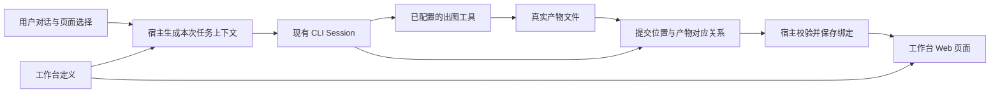
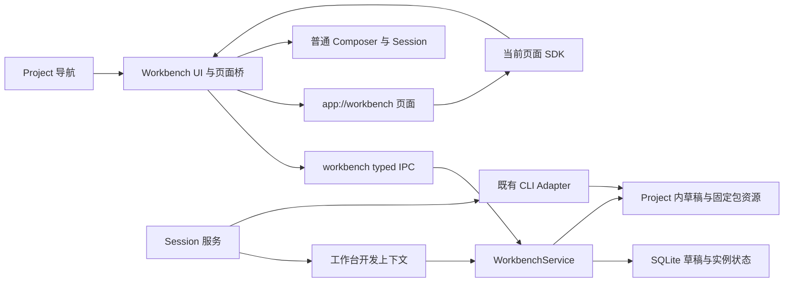

# 用户自定义工作台

## 文档信息

| 项目 | 内容 |
|---|---|
| 模块 | `workbench` |
| 文档状态 | 草稿 |
| 确认范围 | 2026-11-11 确认 09 方案并授权机制实施；§9 为 AI 技术设计，候选业务方案仍后置 |
| 覆盖需求 | FR-VIEW-002、FR-WB-001～FR-WB-008 |
| 相关验收 | [AC-WB-01～08](<../../docs/05. Acceptance Criteria.md#6-插件机制与业务分阶段验收>) |
| 来源 | 用户 2026-11-10 对话：已审阅 09 的讨论问题，全部接受推荐答案，要求替换相关文档旧描述；2026-11-11 要求先设计插件架构、后续验证业务；确认记录见 [09](<../../docs/09. Workbench Discussion.md>)、[DEC-28](<../../docs/07. Decisions.md#dec-28-用户自定义工作台>) |
| 文档职责 | 承接插件架构设计，并保留后续业务的位置、产物与提交方案；区分两阶段的适用边界 |

已确定事项见 [09 §2.1](<../../docs/09. Workbench Discussion.md#21-已确定事项>)。本文保留候选方案，先设计插件架构，再建设机制，后续接入业务。候选交互、架构技术事项与后续业务范围的划分，以及建议、原因和决策时点统一见 [09 §2.2～2.3](<../../docs/09. Workbench Discussion.md#22-未确定事项>)。

## 1. 职责与后续事项

本模块复用 Project、Navigation 和普通 CLI Session，负责自定义页面及其内容状态。五个默认 View 继续由 [Project View spec](../project-view/spec.md)负责。

按 2026-11-11 对话决定，当前实施插件机制。下面列出分层要求，最小机制契约见 §9；阶段状态见[路线图](<../../docs/06. Development Roadmap.md#42-插件架构与工作台建设>)。

### 1.1 插件机制与业务的边界

| 范围 | 架构设计需要回答的问题 | 与业务的关系 |
|---|---|---|
| 宿主与既有模块 | 包登记、Project 实例、导航、页面运行和恢复由谁负责，如何复用现有 Session 与 CLI Adapter | 不另建 Agent 引擎，不把业务生成状态放进通用导航或页面加载流程 |
| 插件包与页面 | 声明、入口、资源、版本、SDK 和加载卸载契约是什么 | 简单页面也能成为插件，不强制提供图片位置、出图能力或产物历史 |
| 宿主通信与状态 | 页面和 AI 可调用哪些接口，状态由谁写入和保存，如何返回错误与释放资源 | 定义通用边界；业务的数据结构、操作与校验后续接入，不提前建设任意业务框架 |
| AI 创建与修改 | 如何提供开发说明、模板、校验反馈、草稿预览和应用更新，并复用普通 CLI Session | 创建插件代码与执行插件内业务分开；出图工具不是创建流程的前置条件 |
| 业务扩展 | 五图等业务如何使用机制，哪些能力属于业务模块，哪些可在实际需求出现后复用 | 在机制具备后设计和验证，不以五图字段反向规定所有插件的基础协议 |

架构交付需给出模块与依赖图、关键模型和接口、创建与运行流程、生命周期及保存恢复方案，并标明涉及产品取舍的未决事项。后续设计应依据现有源码明确具体归属；本期目录、模型和 API 见 §9。

### 1.2 本文现有方案的适用阶段

§2.1 的创建编辑机制、§4.1 的开发说明、§6 的包与实例基础概念、§7 的页面运行边界是架构设计输入，本期提取出的通用契约见 §9。§2 的五图示例、§3 的位置模型、§4 的产物数据流与 §4.2～4.4、§5 的生成与恢复，以及 §6～8 中所有产物、位置和生成执行细节，均保留为后续业务候选方案。

后文的 `workbench.json`、`selectSlots()`、`resolveArtifact()`、`publish_outputs`、位置版本和产物表不构成每个插件的必选契约。是否提取共享的产物服务，在业务接入阶段依据实际复用需要决定。通用插件机制先用简单页面检查创建、预览、添加、打开、修改、重新打开和错误反馈，不以前置五图原型或独立可行性验证作为开工条件。

## 2. FR-WB-001 创建与编辑体验

### 2.1 创建工作台

在宿主提供的“添加工作台”入口中选择 AI 对话创建或已有模板。选择 AI 创建后进入普通 Session，由用户描述所需页面。AI 依据开发说明和模板生成插件包，宿主检查包声明及入口后加载预览，失败时提供可用于修正的反馈。预览使用草稿状态，不能写入已有实例或自动启动出图。

用户在预览中检查页面及交互，也能继续对话调整布局。选择“添加至当前项目”后，宿主登记包版本、创建 Project 内实例并加入左侧导航；添加动作不生成图片。安装前如何展示来源、能力与权限仍需设计，不能把声明中的能力请求视为已经授权。

提供独立的“编辑工作台”入口，通过 AI 对话或本地文件编辑生成草稿版本，再预览并应用。调整布局、标题、颜色或位置定义属于工作台设计；日常对话生成图片只更新内容。导入别人分享的本地包是后续创建方式，阶段范围见[路线图 §4.2](<../../docs/06. Development Roadmap.md#42-插件架构与工作台建设>)。

以下五图示例及 §2.2～2.3 留到后续业务接入，不是插件机制的验收前置条件。

| 稳定位置 ID | 页面名称 | 内容要求示例 |
|---|---|---|
| `cover` | 封面 | 横图，保留标题留白 |
| `character` | 主角 | 方图，角色外观作为后续场景参考 |
| `scene-forest` | 森林场景 | 横图，使用同一主角 |
| `scene-city` | 城市场景 | 横图，使用同一主角 |
| `scene-night` | 夜晚场景 | 横图，使用同一主角 |

这些是可由用户编辑的示例要求。跨图片的角色一致性属于生成目标，系统不能仅凭文件格式检查宣称达成。

### 2.2 对话生成与预览

1. 用户从当前 Project 的左侧导航打开这个工作台实例，在对话中要求“以纸艺风格生成这一整套五张图”。
2. 发送时，宿主记录本次工作台实例、定义版本、页面顺序、用户选中的位置及当前内容版本。输入区显示可查看的工作台上下文，未明确的目标由 AI 读取这份快照后解析，必要时澄清。
3. AI 读取各位置要求及可用能力。若当前 CLI 没有可用的出图工具，界面说明缺少什么能力，保留草稿和已有成果。
4. AI 调用已配置的出图工具，生成真实图片文件。宿主逐项校验并接收产物，把图片绑定到稳定位置 ID。
5. 页面订阅绑定变化，图片逐张出现。成功三张、失败两张时显示真实的部分结果，失败位置可以单独重试。

页面有五个位置，只表示可容纳五项内容。用户说“先做封面”时只生成封面；“把空位置补齐”时才以当前空位置为目标。进入页面、刷新或恢复应用均不自动发起生成。

### 2.3 指定位置继续修改

用户选中森林场景，输入“背景改成夜晚，人物不变”。本次发送携带 `scene-forest`、当前图片引用和本次约束。生成期间继续显示旧图并标记更新状态；新图校验成功后替换当前绑定，旧版本可恢复。

用户说“第三张”时，按发送时的页面顺序解析为稳定位置 ID，并在上下文中显示对应名称。同一消息发出后，即使用户调整排列，返回结果也仍绑定到原目标。没有唯一对应对象时，AI 应先澄清目标。

## 3. FR-WB-002 页面与 AI 共享工作要求

### 3.1 页面与结构化定义

五图等需要内容写回的业务采用自定义 Web 页面配业务结构化定义。声明式组件用于内置模板和简单工作台；AI 按定义中的稳定位置 ID 定位，不能只凭 DOM、截图或文字顺序写回。选择理由见 [09 已确认方向](<../../docs/09. Workbench Discussion.md#1-已确认方向>)。

后续导入已有 HTML 时，须补全内容位置和绑定关系并让用户核对。仅显示网页不代表已经具备内容写回能力。

### 3.2 工作台需要描述的信息

| 概念 | 职责 | 五图示例 |
|---|---|---|
| 工作台插件包 | 可安装、复用的页面、内容定义、默认约束与能力声明；模板是创建包的起点 | 品牌插画包及其版本 |
| 工作台实例 | 某个 Project 中实际使用的工作台及用户设置 | 当前品牌的插画工作台 |
| 内容位置 | 可被独立寻址和更新的内容单元，有稳定 ID、名称、类型和约束 | `scene-forest` 接收一张图片 |
| 产物 | 实际文件或有结构的数据，有类型、来源和版本 | 一张生成的 PNG 图片 |
| 绑定 | 记录某个位置当前使用哪个产物版本 | `scene-forest` 使用图片 A 的第二版 |
| 执行记录 | 关联用户指令、Session 回合、目标位置及提交结果 | 本次只修改森林场景 |

“内容位置”不必是矩形占位框。文章段落、表格数据集、视频片段也可以是独立内容单元。后续首个业务场景只覆盖图片类型，不提前承诺这些编辑器均已支持。

包中的定义同时驱动页面标签、要求说明和 AI 上下文，避免分别维护页面提示词与 AI 提示词。每个可写入位置在页面接口中显式登记绑定，开发预览检查缺失和重复绑定。自定义页面仍可能写错展示逻辑，因此还需运行实际页面核对。

### 3.3 约束的来源和强度

约束分为可机器校验的要求和需要判断的目标。例如文件类型、图片尺寸和每个位置的数量可以检查；风格、构图和人物一致性需要 AI 或用户判断。两类结果分别显示，文件校验通过不等于内容已经被用户接受。

按以下顺序处理要求：

1. 宿主权限与实际工具能力决定哪些操作可执行，工作台文本不能提升权限。
2. 当前工作台定义决定位置类型、必需字段与用户设置的约束。
3. 本次用户指令补充任务目标，可以在定义允许的范围内临时覆盖偏好。

用户指令与必需约束冲突时，先说明冲突并确认是否调整工作台要求。修改工作台定义须进入编辑流程，不让一次出图请求顺带改变页面结构。模板说明、素材文字与外部内容保留来源，不伪装成宿主或用户的高优先级指令。

## 4. FR-WB-003～004 上下文与产物提交



宿主负责包登记、Project 内实例、左侧导航、Session、执行记录、产物接收和页面运行环境。页面负责实例内部的呈现、内容选择和输入。AI 负责理解任务、选择已有能力并提交结果。插件不能通过页面脚本替换宿主导航或接管 Session 生命周期。

### 4.1 页面 SDK 与 AI 开发说明

提供一份随宿主版本维护的开发说明，包含包布局、声明 Schema、SDK 类型、简单页面模板、页面运行约定和错误处理；五图示例在业务接入时补充。AI 创建工作台时读取同一份说明与模板，通过包校验和预览反馈修正代码。开发说明面向页面作者；第 4.2 节的任务上下文面向使用工作台的 AI，两者分开，避免日常出图加载整份开发手册。

本期通用 SDK 由 §9.3 定义。下表保留原业务方案的接口示意，其中位置选择与产物解析留到业务阶段；它不是基础 SDK 的必选接口清单，也不是已实现或稳定的 API：

| 示意操作 | 用途与边界 |
|---|---|
| `getInstance()` | 读取宿主绑定的当前实例、定义和状态，不由页面自由指定其他实例 |
| `subscribe()` | 接收当前实例的状态变化，返回取消订阅方法 |
| `resolveArtifact()` | 将当前实例已授权的产物 ID 解析为受控预览地址 |
| `selectSlots()` | 报告当前选中的稳定位置 ID，由宿主校验 |
| `setDraft()` | 将指令放入用户可编辑的对话草稿，不自动发送 |

开始模型调用继续由用户发送触发，页面加载或渲染不能自行创建隐藏 Session。

页面通过产物 ID 获取可预览资源，不接触任意本机路径、应用数据库、CLI 凭据或整个 `window.studio`。停止某次生成由 Session 负责；关闭或切换页面只解除显示和订阅。

### 4.2 向 AI 提供任务上下文

每次从工作台发送消息时，提供当前实例 ID、定义版本、目标位置、位置内容版本、用户要求及可用能力。位置很多时只传相关摘要，并提供按 ID 读取完整定义和状态的入口。

图片引用是否能被模型读取或作为出图工具的参考图，需要按具体 CLI 和工具验证。一个文件路径不能自动等同于模型已看过图片。参考图无法使用时，应说明能力缺口，不声称保持了角色一致性。

保留用户可见、可移除的工作台上下文。移除后按普通对话处理，本轮不附带自动写回工作台的目标。已有 Session 再次发送时也读取最新位置状态，避免沿用第一轮的旧布局或旧图片。

### 4.3 AI 通过宿主提交结果

宿主提供读取和提交两类核心操作，以下名称为后续业务阶段待设计的接口示意：

| 操作 | 作用 | 关键输入或输出 |
|---|---|---|
| `read_workbench` | 读取本次可操作范围及最新状态 | 定义版本、位置 ID、约束、当前位置版本、可用产物 |
| `publish_outputs` | 提交一项或多项位置更新，返回真实接收结果 | 执行 ID、幂等操作 ID、定义版本、位置版本、产物文件引用 |

下面是一张图片的提交示意，尚未定义正式接口或文件布局：

```json
{
	"runId": "run-18",
	"operationId": "publish-forest-2",
	"definitionRevision": 3,
	"outputs": [
		{
			"slotId": "scene-forest",
			"expectedSlotRevision": 1,
			"stagedPath": "staging/run-18/forest-night.png"
		}
	]
}
```

宿主先确认执行记录归属及目标范围，再检查文件确实存在、能够解码、符合尺寸和类型要求。通过后导入为稳定产物，记录来源并提交绑定，最后返回产物 ID、位置新版本或具体失败原因。AI 的“已经完成”回复不能代替这次提交。

后续业务接入拟先尝试薄的本地命令桥，让已有 CLI 的 Shell 工具调用宿主操作；命令桥使用宿主发放且限定本次执行范围的连接凭据。页面不持有这些凭据。业务接入时检查发现、连接、退出清理和错误回传，再确定采用。若 CLI 无法稳定调用命令桥，再评估 MCP 作为传输方式，业务校验仍由同一宿主服务负责。

[MCP 工具规范的 2025-06-18 版本](https://modelcontextprotocol.io/specification/2025-06-18/server/tools)提供输入 Schema、输出 Schema 与结构化结果的协议参考。它不证明当前 Codex 或 Claude 接入已经支持本方案；具体配置与能力须在业务接入中验证。

### 4.4 出图能力独立于工作台

工作台声明需要 `image.generate`，并可声明参考图编辑等可选能力。能力标识在这里代表产品需求，具体调用方式由当前 CLI 的工具、Skill、MCP 或经确认的服务接入承担。

五图业务接入阶段需接通已指定的出图路径，核对输出文件、参考图支持、停止行为、费用展示及错误反馈。工作台只能请求已授权的能力，不通过页面脚本保存密钥或静默切换付费服务。支持某个 CLI 对话，不等于已经具备出图能力。

宿主的范围校验约束工作台接口，不能收回 CLI 本身已有的本地文件或 Shell 权限。原生 CLI 的执行边界仍按现有 Adapter 与权限配置处理。

## 5. FR-WB-005 部分结果、并发和恢复

把“当前位置的内容”和“正在尝试的新结果”分别记录。更新失败时保留当前图片，失败原因属于本次尝试。页面只能展示实际收到的进度；工具不提供逐图进度时显示处理中，不估算虚假的百分比。

| 情况 | 候选处理方式（待验证与评审） |
|---|---|
| 五张图只成功三张 | 已接收的三张可用；其余标明失败或未返回，重试时明确目标 |
| 工具成功，但提交失败 | 保留暂存产物，先重试提交，避免再次付费生成 |
| 同一次提交被重复发送 | 通过操作 ID 返回原结果；同 ID 携带不同内容时拒绝 |
| 两个 Session 同时修改同一位置 | 比较位置版本，后到的旧版本结果保留为候选并报告冲突，不静默覆盖 |
| 不同位置同时生成 | 按位置版本校验，允许互不冲突的更新分别提交 |
| 用户停止执行 | 保留已接收成果，关闭该执行记录的后续发布权限；迟到结果不能直接替换当前位置 |
| 应用关闭或异常退出 | 恢复最后已提交绑定；未完成尝试标为待核对，不自动重新出图；原生执行能否继续由 CLI 能力决定 |
| 生成期间修改位置类型或删除位置 | 新定义发布后，旧定义下的未提交结果保留为候选，需要重新确认映射 |
| 外部文件被删除 | 显示资源缺失并保留绑定诊断，不把空白区域当作有效成果 |

宿主接收文件时先完成稳定导入，再原子提交绑定与操作记录。崩溃留下的未引用产物可以后续清理，不允许绑定指向尚未写完的文件。一次批量提交中多个目标一起校验、一起更新；需要逐张预览时分别提交，每次使用不同操作 ID。

重试提交可以依赖幂等操作 ID 避免重复绑定。重试生成可能再次产生费用，首期由用户显式发起，并尽量复用已经生成的文件。跨位置依赖需要显式记录：若场景依赖角色图，先生成角色；角色改变后标记受影响场景需要检查，不自动重做全部场景。

## 6. FR-WB-006～007 包、实例与保存

### 6.1 包和实例的标识

插件包描述一种工作台，实例记录它在某个 Project 中的使用情况，产物与绑定属于实例。宿主用 `pluginId + version` 标识包版本，用 `projectId + instanceId` 定位实例。`instanceId` 由宿主分配，不使用包名或用户可改的标题代替。包的 `version`、实例所用的定义修订号和位置内容版本各有用途，不能混用。

同一个包可以在多个 Project 使用，也可以在同一 Project 创建多个实例。例如“品牌 A”和“品牌 B”使用相同五图布局，但设置、图片、草稿和执行记录彼此独立。编辑当前实例时生成独立草稿修订，不能改写其他实例固定使用的包版本；将改动保存为可复用的新包版本属于后续分享流程。

以下是后续五图业务包的布局示意，包含业务定义文件；它不是通用插件包的最小格式，也不代表已确定的目录或实现文件：

```text
brand-illustration/
├── manifest.json
├── workbench.json
├── index.html
├── main.js
└── style.css
```

`workbench.json` 描述稳定位置 ID、类型与约束，页面通过 SDK 绑定这些位置。`manifest.json` 声明包身份、入口和所需能力，例如：

```json
{
	"schemaVersion": 1,
	"pluginId": "local.brand-illustration",
	"version": "0.1.0",
	"title": "品牌插画",
	"sdkVersion": "1",
	"entry": "index.html",
	"definition": "workbench.json",
	"navigation": {
		"title": "品牌插画",
		"icon": "image"
	},
	"capabilities": ["image.generate"]
}
```

上面的完整业务清单仍为后续示意；本期通用字段、版本与 SDK 以 §9 为准，首期导航使用宿主固定图标。位置定义与出图能力留到业务接入。声明只表达所需能力，不能授予权限。入口必须解析到包内受控资源；宿主不按声明执行安装脚本或加载任意后端代码。首期不提供通用后端插件入口。

### 6.2 导航与生命周期

包的 `navigation` 提供实例入口的默认名称和图标，宿主负责渲染、排序和选中状态。导航的稳定标识绑定 `instanceId`，打开时由宿主解析所属 Project 与固定包版本，不使用 `pluginId` 作为唯一路由。用户修改实例名称不会改变 ID，也不会重命名同包的其他实例。

以下动作分别处理，避免隐藏入口时意外丢失成果。下表描述目标行为，插件机制与业务的分阶段范围见[路线图 §4.2](<../../docs/06. Development Roadmap.md#42-插件架构与工作台建设>)。

| 动作或情况 | 候选行为（待所属阶段评审） |
|---|---|
| 安装包、添加实例 | 安装登记可用包版本；添加实例才使它归属当前 Project 并获得导航入口。首期可由“添加至当前项目”合并完成 |
| 打开实例 | 按需加载页面，绑定当前实例的 SDK；不因安装或应用启动加载所有页面 |
| 切换或关闭页面 | 释放页面订阅和运行资源；Session 与已授权的产物提交继续由宿主管理 |
| 取消固定 | 只隐藏左侧入口，保留实例、运行状态和成果；从工作台管理入口可重新打开或固定 |
| 停用实例 | 卸载页面并拒绝新的页面请求，保留入口状态和已有成果；再次启用时从已提交状态读取 |
| 停用期间已有 Session 继续运行 | 允许已授权执行继续提交产物；停用页面不等于停止生成，停止按钮仍调用 Session 的 Stop |
| 删除实例 | 移除活动入口，撤销该实例未完成执行的发布权限；迟到结果不能写回，普通 Session 历史保留，成果默认保留为可恢复记录 |
| 包被停用或尝试卸载 | 停用包影响所有引用实例的页面，数据保留；仍被引用的包版本阻止直接卸载，先处理实例去向 |
| 页面加载失败或崩溃 | 宿主显示错误与重试入口，对话和已保存成果仍可用；修复或回退包版本后重新加载，不自动重做生成 |
| 重启应用 | 恢复实例目录、固定状态、已选包版本与已提交绑定；只加载当前需要展示的页面，不自动启用已停用实例 |

上表为已接受方向下的候选生命周期方案，具体行为与操作呈现须结合所属阶段评审；当前没有交互评审结论。删除实例时是否同时停止运行中的 Session、可恢复记录保存多久、何时彻底删除文件，须在相应操作实施前确定，不能把卸载页面、Stop 和清空数据合成一个动作。停用后的产物提交仍须经过第 4.3 节的校验；用户显式停止执行时按第 5 节撤销后续发布权限。

### 6.3 存储、分享与改版

定义和页面文件保存在可导出的本地工作台包中，实例产物放在当前 Project 的专用目录。宿主数据库保存实例、当前绑定、版本历史与执行记录，作为运行状态的唯一写入入口。工作台使用协议只开放产物更新，不提供直接修改绑定数据库的接口；包文件的修改走编辑工作台流程。

这项存储选择便于原子更新绑定、检测并发版本和记录执行来源，代价是项目文件与宿主状态需要一起备份。首期不要求项目目录自包含全部状态。

图片记录为产物 ID 和受控目录内的相对路径，页面不依赖生成工具的临时绝对路径。实例固定使用一个已校验的包版本；升级失败时应能回到先前版本与对应定义，不能只回退页面而遗留不兼容的绑定。

后续分享阶段，导出包默认包含声明、定义与页面，不携带项目图片、对话或凭据。导出带成果的实例时，需要同时导出状态快照与产物，再通过导入恢复绑定。只复制 Project 文件夹不保证迁移宿主数据库中的状态；具体导入体验在实施前确认。

编辑工作台时生成草稿版本，在预览通过后应用到实例。仅改变排版时保留位置 ID 与已有内容；新增位置保持为空；删除有内容的位置时说明影响并保留可恢复记录。位置类型变化需要重新检查绑定，不能把旧图片误当成新类型的数据。包升级由用户选择应用，不直接改写所有实例。

当前 `.ai-studio/` 的 Git 忽略策略由 [DEC-04](<../../docs/07. Decisions.md#dec-04-project-knowledge-存储>)负责。新包的具体目录、备份与 Git 分享方式需单独落规格，不能在引入工作台时悄悄改变现有忽略策略。

## 7. FR-WB-008 自定义页面运行边界

按 [09 §2.3](<../../docs/09. Workbench Discussion.md#23-架构设计与后续业务技术事项>)的功能优先决定，先设计并建设插件机制。本期采用 iframe 承载页面，页面加载、布局适配、宿主通信、状态更新和卸载契约见 §9.3，不以图片展示或安全专项作为前置条件。

本期页面 SDK 的当前对象读取、状态保存和订阅及对话草稿操作见 §9.3。产物展示、位置选择和绑定更新由后续业务接入。页面卸载时注销订阅，切换和重新打开时恢复对应实例状态；页面加载失败时提供重试入口，并保留对话和已保存成果。

页面安全专项设计与验证在功能完善后另行安排，不作为首期容器选型、功能接入或验收的前置条件。对应后续场景保留在 [AC-WB-07](<../../docs/05. Acceptance Criteria.md#6-插件机制与业务分阶段验收>)。

外部机制的源码依据与可借鉴范围统一见 [Harness 调研](../../docs/references/deepseek-harness/README.md)。导航注册、页面加载、宿主接口和资源清理可供参考，具体容器和接口仍以本项目的功能验证为准。


## 8. 模块接缝与实现验证

| 调用方 | 本模块提供 | 调用方负责 |
|---|---|---|
| Navigation / Project | 当前 Project 的实例目录、稳定实例标识、固定和启用状态 | 宿主入口、选中状态、Project 切换与恢复 |
| Input / Session | 每次发送的工作台快照、执行范围与提交结果 | 可移除上下文、用户发送、普通会话与 Stop；关闭页面不误停会话 |
| CLI Adapter | 受限的读取 / 提交通道及明确错误 | 原生工具调用、权限与会话恢复，不假设所有 CLI 均具备出图能力 |
| 页面容器 | 当前实例 SDK 和产物预览地址 | 页面加载、布局、通信、卸载与故障恢复 |

本表中的产物提交接缝属于后续业务输入。通用插件接缝、模型和包目录见 §9，当前实现与验收结果由对应任务维护。存储变化和跨模块契约按 [Task Protocol](../../tasks/README.md#acceptance)执行适用评审；页面安全专项按第 7 节后置。阶段范围与顺序由路线图负责，验收场景由 05 负责。

## 9. FR-WB-001、006～008 最小插件机制实现契约

依据：用户 2026-11-11 确认 09 方案并授权 agent team 开发至 Harness 对照验收。以下是 Main Agent 在授权范围内确定的技术设计；实现与验收状态由[本次任务](../../tasks/archive/T20261111-workbench-plugins/task.md)维护。§2～8 中的位置、产物、生成执行和分享方案仍属于后续业务。

### 9.1 模块与依赖



宿主管理包校验、版本快照、实例状态和文件响应。Renderer 管理导航、预览、保存反馈和当前页面通信。页面只处理自身呈现和交互。Session 仍独立负责模型请求、历史和 Stop。关闭页面不调用 Stop。默认 Project View 的声明式渲染、Knowledge 和文件监视保持原职责。

### 9.2 清单、包修订与实例

最小包由 `manifest.json` 与本地 HTML 入口组成，可包含 JS、CSS 和静态资源。清单字段以 [PluginManifest](../../apps/desktop/src/shared/workbench/types.ts)为准：`schemaVersion: 1`、`pluginId`、`version`、`sdkVersion: 1`、`title`、`entry`、`capabilities`。首期能力仅为 `state.read`、`state.write` 和 `conversation.draft`，没有图片位置或出图能力要求。能力清单不授予 Node、文件系统、CLI、密钥或付费工具访问权。

草稿位于 `.ai-studio/workbench/drafts/<draftId>/`，应用时携带已预览的 `expectedPackageRevision`，校验当前文件仍对应同一修订后复制到 `.ai-studio/workbench/packages/<revision>/`。文件在预览后变化时须重新预览。修订按内容固定。实例引用该修订，修改草稿不会改变已经打开的实例。包身份和版本描述可复用页面，实例 ID 标识当前 Project 的状态；导航使用 `workbench:<instanceId>`，编辑使用 `workbench-draft:<draftId>`。不向五个默认 View ID 列表添加具体插件。

SQLite 保存草稿来源、编辑目标、实例与包修订的绑定、启用状态及 JSON 状态版本。编辑应用只改变目标实例的包修订，保留其当前已保存状态；预览操作使用草稿自身状态，首次添加保留该草稿已保存状态。其他实例不随编辑更新。所有页面状态写入都经过宿主，带 `expectedRevision`，冲突返回错误供页面重读。该 JSON 状态接口不等于后续业务的文件产物协议。

### 9.3 页面加载与宿主通信

宿主通过 `app://workbench` 返回当前草稿或固定包修订的资源。父 Renderer 仍使用 `app://studio`，只允许嵌入工作台 origin。入口注入随宿主维护的 SDK，页面通过 `window.workbench` 使用以下操作：

| 方法 | 行为 |
|---|---|
| `getInstance()` | 读取当前挂载对象的清单、状态和修订 |
| `updateState(state, expectedRevision)` | 校验并保存 JSON 状态，返回实际保存快照 |
| `subscribe(listener)` | 接收当前对象的状态快照；返回取消订阅函数 |
| `setDraft(text)` | 填入可编辑的普通对话草稿，由用户发送 |

宿主桥只处理当前 iframe 的消息，卸载时注销监听和订阅。页面加载、包校验和状态保存分别反馈；加载错误或脚本异常提供重试。停用卸载页面，保留实例与状态；启用后读取已保存状态，不重新发起模型调用。首期不增加完整包卸载、实例删除和管理中心。

### 9.4 AI 创建与修改

“添加工作台”提供模板和 AI 对话创建。两条路径都创建项目内草稿；AI 创建复用普通 Session，用户发送前不调用模型。开发上下文指向该草稿及随宿主生成的说明、清单 Schema、SDK 类型与模板。AI 修改草稿文件后，用户刷新预览获取真实校验和加载反馈，并可继续对话修正。

“添加至当前项目”登记固定包修订及实例；“编辑工作台”复制当前包为独立草稿。应用前可运行预览，应用后只有编辑目标切换到新修订。普通实例上下文不提供结构修改指令，结构变化由编辑入口承接。开发说明只在创建/编辑 Session 的首次请求附加，路径在该 Session 中保持稳定；后续业务的逐轮目标上下文和产物提交尚未实现。

### 9.5 恢复与备份

重启恢复 Project 导航、实例固定修订、启用状态和最后已保存 JSON 状态。恢复只加载用户当前展示的页面，不自动生成内容。完整备份需要 Project 内 `.ai-studio/workbench/` 文件以及宿主 userData 中的 SQLite 状态；本次不修改 `.ai-studio/` 的 Git 忽略策略。实例导出及可移植备份留到分享阶段。

### 9.6 Harness 对照边界

对照 [Harness 固定源码](../../docs/references/deepseek-harness/README.md)中的 Creator 开发资料、普通会话创建、导航注册、页面加载、宿主操作和清理原则。AI Studio 保留独立草稿预览和 Project 实例；本期不引入 Cordis、profile patch、依赖注入容器、通用模块图、任意后端代码或 DSH 包兼容。真实 CLI 与 UI 结果由任务证据证明，文件存在或模型回复均不能代替可用性验收。
