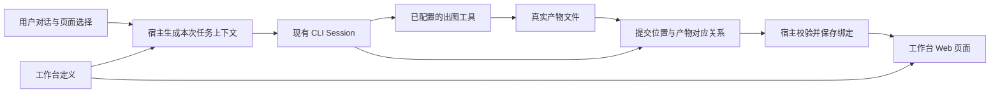
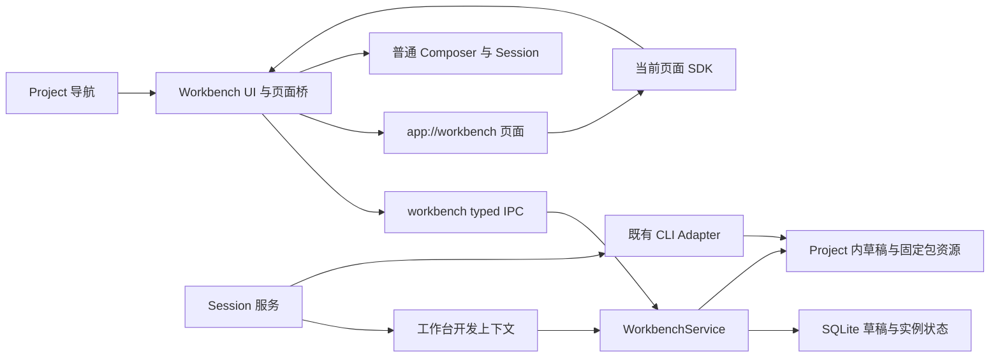
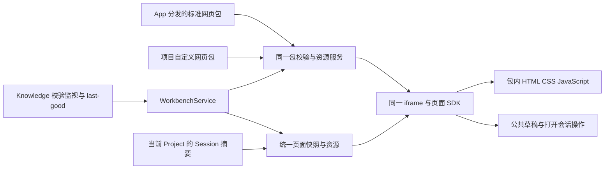

# 工作台

## 文档信息

| 项目 | 内容 |
|---|---|
| 模块 | `workbench` |
| 文档状态 | 草稿 |
| 确认范围 | 2026-11-11 确认 09 方案并授权机制实施；同日确认补齐列表管理，见 §9.8；2026-11-12 确认宿主呈现与选品悬浮条设计，见 §9.7、§9.9；同日确认草稿关闭、模板直接添加与删除实例，见 §9.8；2026-11-13 取消实例停用、移除改为先确认，见 §9.7、§9.8；§9 为 AI 技术设计，候选业务方案仍后置 |
| 覆盖需求 | FR-VIEW-002、FR-WB-001～FR-WB-008 |
| 相关验收 | [AC-WB-01～08](<../../docs/05. Acceptance Criteria.md#6-插件机制与业务分阶段验收>) |
| 来源 | 用户 2026-11-10 对话：已审阅 09 的讨论问题，全部接受推荐答案，要求替换相关文档旧描述；2026-11-11 要求先设计插件架构、后续验证业务；确认记录见 [09](<../../docs/09. Workbench Discussion.md>)、[DEC-28](<../../docs/07. Decisions.md#dec-28-用户自定义工作台>) |
| 文档职责 | 承接插件架构设计，并保留后续业务的位置、产物与提交方案；区分两阶段的适用边界 |

已确定事项见 [09 §2.1](<../../docs/09. Workbench Discussion.md#21-已确定事项>)。本文保留候选方案，先设计插件架构，再建设机制，后续接入业务。候选交互、架构技术事项与后续业务范围的划分，以及建议、原因和决策时点统一见 [09 §2.2～2.3](<../../docs/09. Workbench Discussion.md#22-未确定事项>)。

## 1. 职责与后续事项

本模块复用 Project、Navigation 和普通 CLI Session，负责所有工作台的宿主架构。预设与自定义的产品概念由 [01 Workbench](<../../docs/01. Product Definition.md#workbench>)负责（2026-11-11，DEC-29）。预设网页包使用的 Knowledge 与 Definition 数据由 [Project View spec](../project-view/spec.md)负责；宿主统一契约见 §9.7。

按 2026-11-11 对话决定，当前实施插件机制。下面列出分层要求，最小机制契约见 §9；阶段状态见[路线图](<../../docs/06. Development Roadmap.md#42-插件架构与工作台建设>)。

### 1.1 插件机制与业务的边界

| 范围 | 架构设计需要回答的问题 | 与业务的关系 |
|---|---|---|
| 宿主与既有模块 | 包登记、Project 实例、导航、页面运行和恢复由谁负责，如何复用现有 Session 与 CLI Adapter | 不另建 Agent 引擎，不把业务生成状态放进通用导航或页面加载流程 |
| 插件包与页面 | 声明、入口、资源、版本、SDK 和加载卸载契约是什么 | 简单页面也能成为插件，不强制提供图片位置、出图能力或产物历史 |
| 宿主通信与状态 | 页面和 AI 可调用哪些接口，状态由谁写入和保存，如何返回错误与释放资源 | 定义通用边界；业务的数据结构、操作与校验后续接入，不提前建设任意业务框架 |
| AI 创建与修改 | 如何提供开发说明、模板、校验反馈、草稿预览和应用更新，并复用普通 CLI Session | 创建插件代码与执行插件内业务分开；出图工具不是创建流程的前置条件 |
| 业务扩展 | 五图等业务如何使用机制，哪些能力属于业务模块，哪些可在实际需求出现后复用 | 在机制具备后设计和验证，不以五图字段反向规定所有插件的基础协议 |

架构交付需给出模块与依赖图、关键模型和接口、创建与运行流程、生命周期及保存恢复方案，并标明涉及产品取舍的未决事项。后续设计应依据现有源码明确具体归属；本期目录、模型和 API 见 §9。

### 1.2 本文现有方案的适用阶段

§2.1 的创建编辑机制、§4.1 的开发说明、§6 的包与实例基础概念、§7 的页面运行边界是架构设计输入，本期提取出的通用契约见 §9。§2 的五图示例、§3 的位置模型、§4 的产物数据流与 §4.2～4.4、§5 的生成与恢复，以及 §6～8 中所有产物、位置和生成执行细节，均保留为后续业务候选方案。

后文的 `workbench.json`、`selectSlots()`、`resolveArtifact()`、`publish_outputs`、位置版本和产物表不构成每个插件的必选契约。是否提取共享的产物服务，在业务接入阶段依据实际复用需要决定。通用插件机制先用简单页面检查创建、预览、添加、打开、修改、重新打开和错误反馈，不以前置五图原型或独立可行性验证作为开工条件。

## 2. FR-WB-001 创建与编辑体验

### 2.1 创建工作台

在宿主提供的“添加工作台”入口中选择 AI 对话创建或已有模板。选择 AI 创建后进入普通 Session，由用户描述所需页面。AI 依据开发说明和模板生成插件包，宿主检查包声明及入口后加载预览，失败时提供可用于修正的反馈。预览使用草稿状态，不能写入已有实例或自动启动出图。

用户在预览中检查页面及交互，也能继续对话调整布局。选择“添加至当前项目”后，宿主登记包版本、创建 Project 内实例并加入左侧导航；添加动作不生成图片。安装前如何展示来源、能力与权限仍需设计，不能把声明中的能力请求视为已经授权。

提供独立的“编辑工作台”入口，通过 AI 对话或本地文件编辑生成草稿版本，再预览并应用。调整布局、标题、颜色或位置定义属于工作台设计；日常对话生成图片只更新内容。导入别人分享的本地包是后续创建方式，阶段范围见[路线图 §4.2](<../../docs/06. Development Roadmap.md#42-插件架构与工作台建设>)。

以下五图示例及 §2.2～2.3 留到后续业务接入，不是插件机制的验收前置条件。

| 稳定位置 ID | 页面名称 | 内容要求示例 |
|---|---|---|
| `cover` | 封面 | 横图，保留标题留白 |
| `character` | 主角 | 方图，角色外观作为后续场景参考 |
| `scene-forest` | 森林场景 | 横图，使用同一主角 |
| `scene-city` | 城市场景 | 横图，使用同一主角 |
| `scene-night` | 夜晚场景 | 横图，使用同一主角 |

这些是可由用户编辑的示例要求。跨图片的角色一致性属于生成目标，系统不能仅凭文件格式检查宣称达成。

### 2.2 对话生成与预览

1. 用户从当前 Project 的左侧导航打开这个工作台实例，在对话中要求“以纸艺风格生成这一整套五张图”。
2. 发送时，宿主记录本次工作台实例、定义版本、页面顺序、用户选中的位置及当前内容版本。输入区显示可查看的工作台上下文，未明确的目标由 AI 读取这份快照后解析，必要时澄清。
3. AI 读取各位置要求及可用能力。若当前 CLI 没有可用的出图工具，界面说明缺少什么能力，保留草稿和已有成果。
4. AI 调用已配置的出图工具，生成真实图片文件。宿主逐项校验并接收产物，把图片绑定到稳定位置 ID。
5. 页面订阅绑定变化，图片逐张出现。成功三张、失败两张时显示真实的部分结果，失败位置可以单独重试。

页面有五个位置，只表示可容纳五项内容。用户说“先做封面”时只生成封面；“把空位置补齐”时才以当前空位置为目标。进入页面、刷新或恢复应用均不自动发起生成。

### 2.3 指定位置继续修改

用户选中森林场景，输入“背景改成夜晚，人物不变”。本次发送携带 `scene-forest`、当前图片引用和本次约束。生成期间继续显示旧图并标记更新状态；新图校验成功后替换当前绑定，旧版本可恢复。

用户说“第三张”时，按发送时的页面顺序解析为稳定位置 ID，并在上下文中显示对应名称。同一消息发出后，即使用户调整排列，返回结果也仍绑定到原目标。没有唯一对应对象时，AI 应先澄清目标。

## 3. FR-WB-002 页面与 AI 共享工作要求

### 3.1 页面与结构化定义

五图等需要内容写回的业务采用自定义 Web 页面配业务结构化定义。声明式组件用于内置模板和简单工作台；AI 按定义中的稳定位置 ID 定位，不能只凭 DOM、截图或文字顺序写回。选择理由见 [09 已确认方向](<../../docs/09. Workbench Discussion.md#1-已确认方向>)。

后续导入已有 HTML 时，须补全内容位置和绑定关系并让用户核对。仅显示网页不代表已经具备内容写回能力。

### 3.2 工作台需要描述的信息

| 概念 | 职责 | 五图示例 |
|---|---|---|
| 工作台插件包 | 可安装、复用的页面、内容定义、默认约束与能力声明；模板是创建包的起点 | 品牌插画包及其版本 |
| 工作台实例 | 某个 Project 中实际使用的工作台及用户设置 | 当前品牌的插画工作台 |
| 内容位置 | 可被独立寻址和更新的内容单元，有稳定 ID、名称、类型和约束 | `scene-forest` 接收一张图片 |
| 产物 | 实际文件或有结构的数据，有类型、来源和版本 | 一张生成的 PNG 图片 |
| 绑定 | 记录某个位置当前使用哪个产物版本 | `scene-forest` 使用图片 A 的第二版 |
| 执行记录 | 关联用户指令、Session 回合、目标位置及提交结果 | 本次只修改森林场景 |

“内容位置”不必是矩形占位框。文章段落、表格数据集、视频片段也可以是独立内容单元。后续首个业务场景只覆盖图片类型，不提前承诺这些编辑器均已支持。

包中的定义同时驱动页面标签、要求说明和 AI 上下文，避免分别维护页面提示词与 AI 提示词。每个可写入位置在页面接口中显式登记绑定，开发预览检查缺失和重复绑定。自定义页面仍可能写错展示逻辑，因此还需运行实际页面核对。

### 3.3 约束的来源和强度

约束分为可机器校验的要求和需要判断的目标。例如文件类型、图片尺寸和每个位置的数量可以检查；风格、构图和人物一致性需要 AI 或用户判断。两类结果分别显示，文件校验通过不等于内容已经被用户接受。

按以下顺序处理要求：

1. 宿主权限与实际工具能力决定哪些操作可执行，工作台文本不能提升权限。
2. 当前工作台定义决定位置类型、必需字段与用户设置的约束。
3. 本次用户指令补充任务目标，可以在定义允许的范围内临时覆盖偏好。

用户指令与必需约束冲突时，先说明冲突并确认是否调整工作台要求。修改工作台定义须进入编辑流程，不让一次出图请求顺带改变页面结构。模板说明、素材文字与外部内容保留来源，不伪装成宿主或用户的高优先级指令。

## 4. FR-WB-003～004 上下文与产物提交



宿主负责包登记、Project 内实例、左侧导航、Session、执行记录、产物接收和页面运行环境。页面负责实例内部的呈现、内容选择和输入。AI 负责理解任务、选择已有能力并提交结果。插件不能通过页面脚本替换宿主导航或接管 Session 生命周期。

### 4.1 页面 SDK 与 AI 开发说明

提供一份随宿主版本维护的开发说明，包含包布局、声明 Schema、SDK 类型、简单页面模板、页面运行约定和错误处理；五图示例在业务接入时补充。AI 创建工作台时读取同一份说明与模板，通过包校验和预览反馈修正代码。开发说明面向页面作者；第 4.2 节的任务上下文面向使用工作台的 AI，两者分开，避免日常出图加载整份开发手册。

本期通用 SDK 由 §9.3 定义。下表保留原业务方案的接口示意，其中位置选择与产物解析留到业务阶段；它不是基础 SDK 的必选接口清单，也不是已实现或稳定的 API：

| 示意操作 | 用途与边界 |
|---|---|
| `getInstance()` | 读取宿主绑定的当前实例、定义和状态，不由页面自由指定其他实例 |
| `subscribe()` | 接收当前实例的状态变化，返回取消订阅方法 |
| `resolveArtifact()` | 将当前实例已授权的产物 ID 解析为受控预览地址 |
| `selectSlots()` | 报告当前选中的稳定位置 ID，由宿主校验 |
| `setDraft()` | 将指令放入用户可编辑的对话草稿，不自动发送 |

开始模型调用继续由用户发送触发，页面加载或渲染不能自行创建隐藏 Session。

页面通过产物 ID 获取可预览资源，不接触任意本机路径、应用数据库、CLI 凭据或整个 `window.studio`。停止某次生成由 Session 负责；关闭或切换页面只解除显示和订阅。

### 4.2 向 AI 提供任务上下文

每次从工作台发送消息时，提供当前实例 ID、定义版本、目标位置、位置内容版本、用户要求及可用能力。位置很多时只传相关摘要，并提供按 ID 读取完整定义和状态的入口。

图片引用是否能被模型读取或作为出图工具的参考图，需要按具体 CLI 和工具验证。一个文件路径不能自动等同于模型已看过图片。参考图无法使用时，应说明能力缺口，不声称保持了角色一致性。

保留用户可见、可移除的工作台上下文。移除后按普通对话处理，本轮不附带自动写回工作台的目标。已有 Session 再次发送时也读取最新位置状态，避免沿用第一轮的旧布局或旧图片。

### 4.3 AI 通过宿主提交结果

宿主提供读取和提交两类核心操作，以下名称为后续业务阶段待设计的接口示意：

| 操作 | 作用 | 关键输入或输出 |
|---|---|---|
| `read_workbench` | 读取本次可操作范围及最新状态 | 定义版本、位置 ID、约束、当前位置版本、可用产物 |
| `publish_outputs` | 提交一项或多项位置更新，返回真实接收结果 | 执行 ID、幂等操作 ID、定义版本、位置版本、产物文件引用 |

下面是一张图片的提交示意，尚未定义正式接口或文件布局：

```json
{
	"runId": "run-18",
	"operationId": "publish-forest-2",
	"definitionRevision": 3,
	"outputs": [
		{
			"slotId": "scene-forest",
			"expectedSlotRevision": 1,
			"stagedPath": "staging/run-18/forest-night.png"
		}
	]
}
```

宿主先确认执行记录归属及目标范围，再检查文件确实存在、能够解码、符合尺寸和类型要求。通过后导入为稳定产物，记录来源并提交绑定，最后返回产物 ID、位置新版本或具体失败原因。AI 的“已经完成”回复不能代替这次提交。

后续业务接入拟先尝试薄的本地命令桥，让已有 CLI 的 Shell 工具调用宿主操作；命令桥使用宿主发放且限定本次执行范围的连接凭据。页面不持有这些凭据。业务接入时检查发现、连接、退出清理和错误回传，再确定采用。若 CLI 无法稳定调用命令桥，再评估 MCP 作为传输方式，业务校验仍由同一宿主服务负责。

[MCP 工具规范的 2025-06-18 版本](https://modelcontextprotocol.io/specification/2025-06-18/server/tools)提供输入 Schema、输出 Schema 与结构化结果的协议参考。它不证明当前 Codex 或 Claude 接入已经支持本方案；具体配置与能力须在业务接入中验证。

### 4.4 出图能力独立于工作台

工作台声明需要 `image.generate`，并可声明参考图编辑等可选能力。能力标识在这里代表产品需求，具体调用方式由当前 CLI 的工具、Skill、MCP 或经确认的服务接入承担。

五图业务接入阶段需接通已指定的出图路径，核对输出文件、参考图支持、停止行为、费用展示及错误反馈。工作台只能请求已授权的能力，不通过页面脚本保存密钥或静默切换付费服务。支持某个 CLI 对话，不等于已经具备出图能力。

宿主的范围校验约束工作台接口，不能收回 CLI 本身已有的本地文件或 Shell 权限。原生 CLI 的执行边界仍按现有 Adapter 与权限配置处理。

## 5. FR-WB-005 部分结果、并发和恢复

把“当前位置的内容”和“正在尝试的新结果”分别记录。更新失败时保留当前图片，失败原因属于本次尝试。页面只能展示实际收到的进度；工具不提供逐图进度时显示处理中，不估算虚假的百分比。

| 情况 | 候选处理方式（待验证与评审） |
|---|---|
| 五张图只成功三张 | 已接收的三张可用；其余标明失败或未返回，重试时明确目标 |
| 工具成功，但提交失败 | 保留暂存产物，先重试提交，避免再次付费生成 |
| 同一次提交被重复发送 | 通过操作 ID 返回原结果；同 ID 携带不同内容时拒绝 |
| 两个 Session 同时修改同一位置 | 比较位置版本，后到的旧版本结果保留为候选并报告冲突，不静默覆盖 |
| 不同位置同时生成 | 按位置版本校验，允许互不冲突的更新分别提交 |
| 用户停止执行 | 保留已接收成果，关闭该执行记录的后续发布权限；迟到结果不能直接替换当前位置 |
| 应用关闭或异常退出 | 恢复最后已提交绑定；未完成尝试标为待核对，不自动重新出图；原生执行能否继续由 CLI 能力决定 |
| 生成期间修改位置类型或删除位置 | 新定义发布后，旧定义下的未提交结果保留为候选，需要重新确认映射 |
| 外部文件被删除 | 显示资源缺失并保留绑定诊断，不把空白区域当作有效成果 |

宿主接收文件时先完成稳定导入，再原子提交绑定与操作记录。崩溃留下的未引用产物可以后续清理，不允许绑定指向尚未写完的文件。一次批量提交中多个目标一起校验、一起更新；需要逐张预览时分别提交，每次使用不同操作 ID。

重试提交可以依赖幂等操作 ID 避免重复绑定。重试生成可能再次产生费用，首期由用户显式发起，并尽量复用已经生成的文件。跨位置依赖需要显式记录：若场景依赖角色图，先生成角色；角色改变后标记受影响场景需要检查，不自动重做全部场景。

## 6. FR-WB-006～007 包、实例与保存

### 6.1 包和实例的标识

插件包描述一种工作台，实例记录它在某个 Project 中的使用情况，产物与绑定属于实例。宿主用 `pluginId + version` 标识包版本，用 `projectId + instanceId` 定位实例。`instanceId` 由宿主分配，不使用包名或用户可改的标题代替。包的 `version`、实例所用的定义修订号和位置内容版本各有用途，不能混用。

同一个包可以在多个 Project 使用，也可以在同一 Project 创建多个实例。例如“品牌 A”和“品牌 B”使用相同五图布局，但设置、图片、草稿和执行记录彼此独立。编辑当前实例时生成独立草稿修订，不能改写其他实例固定使用的包版本；将改动保存为可复用的新包版本属于后续分享流程。

以下是后续五图业务包的布局示意，包含业务定义文件；它不是通用插件包的最小格式，也不代表已确定的目录或实现文件：

```text
brand-illustration/
├── manifest.json
├── workbench.json
├── index.html
├── main.js
└── style.css
```

`workbench.json` 描述稳定位置 ID、类型与约束，页面通过 SDK 绑定这些位置。`manifest.json` 声明包身份、入口和所需能力，例如：

```json
{
	"schemaVersion": 1,
	"pluginId": "local.brand-illustration",
	"version": "0.1.0",
	"title": "品牌插画",
	"sdkVersion": "1",
	"entry": "index.html",
	"definition": "workbench.json",
	"navigation": {
		"title": "品牌插画",
		"icon": "image"
	},
	"capabilities": ["image.generate"]
}
```

上面的完整业务清单仍为后续示意；本期通用字段、版本与 SDK 以 §9 为准，首期导航使用宿主固定图标。位置定义与出图能力留到业务接入。声明只表达所需能力，不能授予权限。入口必须解析到包内受控资源；宿主不按声明执行安装脚本或加载任意后端代码。首期不提供通用后端插件入口。

### 6.2 导航与生命周期

包的 `navigation` 提供实例入口的默认名称和图标，宿主负责渲染、排序和选中状态。导航的稳定标识绑定 `instanceId`，打开时由宿主解析所属 Project 与固定包版本，不使用 `pluginId` 作为唯一路由。用户修改实例名称不会改变 ID，也不会重命名同包的其他实例。

以下动作分别处理，避免隐藏入口时意外丢失成果。下表描述目标行为，插件机制与业务的分阶段范围见[路线图 §4.2](<../../docs/06. Development Roadmap.md#42-插件架构与工作台建设>)。

| 动作或情况 | 候选行为（待所属阶段评审） |
|---|---|
| 安装包、添加实例 | 安装登记可用包版本；添加实例才使它归属当前 Project 并获得导航入口。首期可由“添加至当前项目”合并完成 |
| 打开实例 | 按需加载页面，绑定当前实例的 SDK；不因安装或应用启动加载所有页面 |
| 切换或关闭页面 | 释放页面订阅和运行资源；Session 与已授权的产物提交继续由宿主管理 |
| 取消固定 | 只隐藏左侧入口，保留实例、运行状态和成果；从工作台管理入口可重新打开或固定 |
| 删除实例 | 先移除再从“已移除”中永久删除；删除前停止从该实例及其编辑草稿发起、仍在运行的 Session，删除实例记录与已保存状态。普通 Session 历史、项目文件和包文件保留；本期行为见 §9.8 |
| 包被停用或尝试卸载 | 停用包影响所有引用实例的页面，数据保留；仍被引用的包版本阻止直接卸载，先处理实例去向 |
| 页面加载失败或崩溃 | 宿主显示错误与重试入口，对话和已保存成果仍可用；修复或回退包版本后重新加载，不自动重做生成 |
| 重启应用 | 恢复实例目录、固定状态、已选包版本与已提交绑定；只加载当前需要展示的页面 |

上表为已接受方向下的候选生命周期方案，具体行为与操作呈现须结合所属阶段评审。删除实例的 Stop 与数据范围已于 2026-11-12 确认（§9.8）；业务产物的可恢复记录与包、草稿文件何时彻底清理仍须在相应操作实施前确定。卸载页面、Stop 和清空数据仍是分开的动作，删除只在用户确认后依次执行。实例不提供停用，隐藏入口使用取消固定（§9.8 的移除），见 [DEC-32](<../../docs/07. Decisions.md#dec-32-取消工作台停用移除先确认>)。用户显式停止执行时按第 5 节撤销后续发布权限。

### 6.3 存储、分享与改版

定义和页面文件保存在可导出的本地工作台包中，实例产物放在当前 Project 的专用目录。宿主数据库保存实例、当前绑定、版本历史与执行记录，作为运行状态的唯一写入入口。工作台使用协议只开放产物更新，不提供直接修改绑定数据库的接口；包文件的修改走编辑工作台流程。

这项存储选择便于原子更新绑定、检测并发版本和记录执行来源，代价是项目文件与宿主状态需要一起备份。首期不要求项目目录自包含全部状态。

图片记录为产物 ID 和受控目录内的相对路径，页面不依赖生成工具的临时绝对路径。实例固定使用一个已校验的包版本；升级失败时应能回到先前版本与对应定义，不能只回退页面而遗留不兼容的绑定。

后续分享阶段，导出包默认包含声明、定义与页面，不携带项目图片、对话或凭据。导出带成果的实例时，需要同时导出状态快照与产物，再通过导入恢复绑定。只复制 Project 文件夹不保证迁移宿主数据库中的状态；具体导入体验在实施前确认。

编辑工作台时生成草稿版本，在预览通过后应用到实例。仅改变排版时保留位置 ID 与已有内容；新增位置保持为空；删除有内容的位置时说明影响并保留可恢复记录。位置类型变化需要重新检查绑定，不能把旧图片误当成新类型的数据。包升级由用户选择应用，不直接改写所有实例。

当前 `.ai-studio/` 的 Git 忽略策略由 [DEC-04](<../../docs/07. Decisions.md#dec-04-project-knowledge-存储>)负责。新包的具体目录、备份与 Git 分享方式需单独落规格，不能在引入工作台时悄悄改变现有忽略策略。

## 7. FR-WB-008 自定义页面运行边界

按 [09 §2.3](<../../docs/09. Workbench Discussion.md#23-架构设计与后续业务技术事项>)的功能优先决定，先设计并建设插件机制。本期采用 iframe 承载页面，页面加载、布局适配、宿主通信、状态更新和卸载契约见 §9.3，不以图片展示或安全专项作为前置条件。

本期页面 SDK 的当前对象读取、状态保存和订阅及对话草稿操作见 §9.3。选品节点的文本结果由 §9.9 接入；图片产物展示、位置选择和绑定更新由后续业务接入。页面卸载时注销订阅，切换和重新打开时恢复对应实例状态；页面加载失败时提供重试入口，并保留对话和已保存成果。

页面安全专项设计与验证在功能完善后另行安排，不作为首期容器选型、功能接入或验收的前置条件。对应后续场景保留在 [AC-WB-07](<../../docs/05. Acceptance Criteria.md#6-插件机制与业务分阶段验收>)。

外部机制的源码依据与可借鉴范围统一见 [Harness 调研](../../docs/references/deepseek-harness/README.md)。导航注册、页面加载、宿主接口和资源清理可供参考，具体容器和接口仍以本项目的功能验证为准。


## 8. 模块接缝与实现验证

| 调用方 | 本模块提供 | 调用方负责 |
|---|---|---|
| Navigation / Project | 当前 Project 的实例目录、稳定实例标识和固定状态 | 宿主入口、选中状态、Project 切换与恢复 |
| Input / Session | 每次发送的工作台快照、执行范围与提交结果 | 可移除上下文、用户发送、普通会话与 Stop；关闭页面不误停会话 |
| CLI Adapter | 受限的读取 / 提交通道及明确错误 | 原生工具调用、权限与会话恢复，不假设所有 CLI 均具备出图能力 |
| 页面容器 | 当前实例 SDK 和产物预览地址 | 页面加载、布局、通信、卸载与故障恢复 |

本表中的产物提交接缝属于后续业务输入。通用插件接缝、模型和包目录见 §9，当前实现与验收结果由对应任务维护。存储变化和跨模块契约按 [Task Protocol](../../tasks/README.md#acceptance)执行适用评审；页面安全专项按第 7 节后置。阶段范围与顺序由路线图负责，验收场景由 05 负责。

## 9. FR-WB-001、006～008 最小插件机制实现契约

依据：用户 2026-11-11 确认 09 方案并授权 agent team 开发至 Harness 对照验收。以下是 Main Agent 在授权范围内确定的技术设计；实现与验收状态由[本次任务](../../.agents/archive/tasks/T20261111-workbench-plugins/task.md)维护。§2～8 中的位置、产物、生成执行和分享方案仍属于后续业务。

### 9.1 模块与依赖



宿主管理包校验、版本快照、实例状态和文件响应。Renderer 管理导航、预览、保存反馈和当前页面通信。页面只处理自身呈现和交互。Session 仍独立负责模型请求、历史和 Stop。关闭页面不调用 Stop。所有页面使用同一种 Web 包运行方式。Knowledge 的校验、文件监视和 last-good 作为通用数据资源提供，详见 §9.7。

### 9.2 清单、包修订与实例

最小包由 `manifest.json` 与本地 HTML 入口组成，可包含 JS、CSS 和静态资源。清单字段以 [PluginManifest](../../apps/desktop/src/shared/workbench/types.ts)为准：`schemaVersion: 1`、`pluginId`、`version`、`sdkVersion: 1`、`title`、`entry`、`capabilities`。基础能力为 `state.read`、`state.write` 和 `conversation.draft`；资源能力见 §9.7，真实节点执行能力 `agent.execute` 见 §9.9。能力清单不提供任意 Node、文件系统或密钥访问；节点请求由宿主已有 Session Provider 执行。

草稿位于 `.ai-studio/workbench/drafts/<draftId>/`，应用时携带已预览的 `expectedPackageRevision`，校验当前文件仍对应同一修订后复制到 `.ai-studio/workbench/packages/<revision>/`。文件在预览后变化时须重新预览。修订按内容固定。实例引用该修订，修改草稿不会改变已经打开的实例。包身份和版本描述可复用页面，实例 ID 标识当前 Project 的状态；导航使用 `workbench:<instanceId>`，编辑使用 `workbench-draft:<draftId>`。统一目录由 App 预设、Project 内实例及设计草稿合成，预设声明是其稳定 ID、标题及顺序的唯一来源。

SQLite 保存草稿来源、编辑目标、实例与包修订的绑定及 JSON 状态版本。编辑应用只改变目标实例的包修订，保留其当前已保存状态；预览操作使用草稿自身状态，首次添加保留该草稿已保存状态。添加或应用成功后草稿关闭：宿主删除草稿记录，首次添加的实例接替草稿在列表中的位置与名称，草稿文件保留在磁盘。其他实例不随编辑更新。所有页面状态写入都经过宿主，带 `expectedRevision`，冲突返回错误供页面重读。该 JSON 状态接口不等于后续业务的文件产物协议。

### 9.3 页面加载与宿主通信

宿主通过 `app://workbench` 返回当前草稿或固定包修订的资源。父 Renderer 仍使用 `app://studio`，只允许嵌入工作台 origin。入口注入随宿主维护的 SDK，页面通过 `window.workbench` 使用以下操作：

| 方法 | 行为 |
|---|---|
| `getInstance()` | 读取当前挂载对象的清单、状态和修订 |
| `updateState(state, expectedRevision)` | 校验并保存 JSON 状态，返回实际保存快照 |
| `subscribe(listener)` | 接收当前对象的状态快照；返回取消订阅函数 |
| `setDraft(text, options?)` | 填入可编辑的普通对话草稿，由用户发送 |

宿主桥只处理当前 iframe 的消息，卸载时注销监听和订阅。页面加载、包校验和状态保存分别反馈；加载错误或脚本异常提供重试。页面卸载后重新打开时读取已保存状态，不重新发起模型调用。基础列表管理与实例永久删除见 §9.8；完整包卸载和管理中心继续后置。

### 9.4 AI 创建与修改

“添加工作台”提供模板和 AI 对话创建。两条路径都创建项目内草稿；AI 创建复用普通 Session，用户发送前不调用模型。开发上下文指向该草稿及随宿主生成的说明、清单 Schema、SDK 类型与模板。AI 修改草稿文件后，用户在“更多操作”中重新加载，获取真实校验和加载反馈，并可继续对话修正。

“添加至当前项目”登记固定包修订及实例；“编辑工作台”复制当前包为独立草稿，同一实例已有基于当前修订、来源相同的未应用草稿时直接打开它，不再新建，也不覆盖对话框中已输入的内容。应用前可运行预览，应用后只有编辑目标切换到新修订，草稿随之关闭。普通实例上下文不提供结构修改指令，结构变化由编辑入口承接。开发说明只在创建/编辑 Session 的首次请求附加，路径在该 Session 中保持稳定；后续业务的逐轮目标上下文和产物提交尚未实现。

### 9.5 恢复与备份

重启恢复 Project 导航、实例固定修订和最后已保存 JSON 状态。恢复只加载用户当前展示的页面，不自动生成内容。完整备份需要 Project 内 `.ai-studio/workbench/` 文件以及宿主 userData 中的 SQLite 状态；本次不修改 `.ai-studio/` 的 Git 忽略策略。实例导出及可移植备份留到分享阶段。

### 9.6 Harness 对照边界

对照 [Harness 固定源码](../../docs/references/deepseek-harness/README.md)中的 Creator 开发资料、普通会话创建、导航注册、页面加载、宿主操作和清理原则。AI Studio 保留独立草稿预览和 Project 实例；本期不引入 Cordis、profile patch、依赖注入容器、通用模块图、任意后端代码或 DSH 包兼容。真实 CLI 与 UI 结果由任务证据证明，文件存在或模型回复均不能代替可用性验收。

### 9.7 预设与自定义工作台统一宿主

所有工作台使用相同的标准网页插件包、校验、资源服务、iframe、SDK、快照和生命周期。预设包由 App 分发，自定义包来自项目草稿；来源只决定资源位置和已有管理操作，不选择另一种页面格式或 Renderer。产品决定见 [DEC-29](<../../docs/07. Decisions.md#dec-29-预设与自定义工作台统一架构>)，本轮实施与验证见[网页格式统一任务](../../.agents/archive/tasks/T20261111-workbench-web-format/task.md)。



#### 标准包与交付

五个预设均包含 `manifest.json`、HTML 入口和包内 JavaScript、CSS 资源。清单使用同一 `PluginManifest` Schema；生成后的完整包经同一 `readPackage` 校验、引用检查和内容修订计算。构建生成的预设包位于应用 `out/workbench-packages/`，实际桌面包包含同一目录。运行时不依赖源码目录、开发服务器、CDN 或预设专用协议。

预设的页面内容全部位于 iframe，包括知识展示、错误与空态、生成按钮及 Overview 的三个 Session 分组。Knowledge Definition 可以由包内脚本解释；它是页面的业务数据，不是宿主的另一种页面运行方式。宿主不保留原生 KnowledgePreview、Overview 内容组件或按 `runtime` 选择 Renderer 的分支。

预设包复制为普通自定义草稿后，使用相同的资源声明、SDK 与页面操作即可运行，不依赖预设 ID 的隐藏通道。

#### 目录、身份与快照

`WorkbenchService` 统一提供目录、`{ projectId, viewId }` 定位、上下文、快照与 `workbench` typed IPC。预设清单是标题与包信息的来源；App 注册信息维护稳定路由和默认顺序。预设仍是 Project 内的虚拟实例，打开不插入实例记录或创建事实文件。

保留 `overview`、`progress`、`architecture`、`agent-team`、`business-flow`、`workbench:<id>` 和 `workbench-draft:<id>`。已有 MainCanvas、Session 的 `originViewId`、输入草稿键及 Knowledge 路径不迁移。

`WorkbenchSnapshot` 统一包含定位、目录条目、读取状态、错误、宿主排序版本及页面快照，不再按声明式或 Web 划分类型。页面保留 SDK 1 的 target、清单、包修订、JSON state、stateRevision 和资源地址；实例不提供停用，快照不含 `enabled`（DEC-32）。宿主排序版本用于异步读取和事件去重，stateRevision 仅用于 JSON 状态 CAS。

#### 公共数据能力与页面操作

| 声明或操作 | 数据与边界 |
|---|---|
| `project.knowledge.read` 与 `knowledgeViewId` | 指定已有 Knowledge/Definition 源，宿主读取、校验、监视并在 `resources.knowledge` 中提供状态、错误及 last-good 文档；任何来源的包均可声明 |
| `project.sessions.read` | 在 `resources.sessions` 中提供当前 Project 的最小 Session 摘要，页面自行完成排序和分组，不提供 transcript、凭据或其他 Project 的数据 |
| `session.open` 与 `openSession()` | 通过当前挂载工作台打开同 Project 的已有会话；校验所属关系和页面仍有效，不创建、发送或停止 Session |
| `conversation.draft` 与 `setDraft()` | 默认填写当前对话草稿；`target: new` 进入当前工作台的新对话草稿。两者均由用户确认发送 |

资源随既有 `getInstance()` 与 `subscribe()` 通道更新。Knowledge 错误保留 last-good 资源和当前页面，不能把正常网页包判成加载失败或改变 iframe 地址。自定义包请求同一能力时获得相同协议；不能只为预设提供未声明特权。

页面只通过绑定到当前挂载实例的 SDK 访问宿主。Session 仍拥有会话状态，Knowledge 文件仍是知识事实的唯一来源，JSON state 继续由宿主 CAS 管理；不把 Knowledge 另存成可写的 SQLite 事实副本。

#### 生命周期与通用呈现

一个 Renderer store 保存全部工作台目录、页面快照及每个页面的宿主状态（页面连接、保存状态、操作错误与进行中的操作），右侧区域标题栏与页面主体读取同一份状态。所有网页包共享 iframe、资源订阅与下述宿主呈现。主题通过公共页面环境提供，不直接读取父窗口 DOM 或宿主 store。Project 关闭后清理缓存与监听，拒绝迟到的读取和页面动作。

宿主呈现按用户 2026-11-12 确认的设计（[DEC-30](<../../docs/07. Decisions.md#dec-30-工作台宿主精简系统字体与中文界面>)；设计稿见[高保真界面索引](../../design/screens/README.md#3-方案索引)）；停用的呈现已按 [DEC-32](<../../docs/07. Decisions.md#dec-32-取消工作台停用移除先确认>) 取消：

| 位置 | 呈现 |
|---|---|
| 页面区域 | 页面紧接右侧区域标题栏，宿主不在页面上方另设阶段、插件信息或检查状态行。宿主不提供页面缩放；需要缩放的页面（如选品画布）自行提供 |
| 标题后的状态标记 | 运行正常只显示状态点，悬停提示与读屏给出“运行正常 · 保存状态”；检查包、加载页面与等待页面文件显示文字；页面出错或保存失败显示出错状态；草稿另显示“草稿”标记 |
| 草稿主按钮 | 草稿在标题栏提供“添加至当前项目”，编辑草稿为“应用更改” |
| “更多操作”菜单 | 位于工具切换组之后：“编辑工作台”（自定义实例）、“重新加载”、“关于此工作台” |
| 关于此工作台 | 对话框列出来源、标识、版本、状态、以中文描述的页面能力和备份说明；草稿另列草稿目录 |
| 标题栏下方 | 草稿说明与选品模板升级提示各为一行提示。页面出错时显示错误提示，提供“重试预览”和“将错误填入对话” |

技术决定（AI，2026-11-12）：沿用现有操作名称，不采用设计稿中的近义写法；草稿说明与升级提示保留为标题栏下方的单行提示，不覆盖页面，避免遮挡页面自己的控件；“将错误填入对话”只填写草稿，不自动发送。Project 壳层为右侧区域标题栏提供 `PreviewHeader` 插槽，工作台通过它接入状态标记、草稿主按钮与菜单。实施与验证见[界面规范化任务](../../.agents/archive/tasks/T20261112-workbench-ui-polish/task.md)。

技术决定（AI，2026-11-13）：取消停用后删除 `workbench:set-enabled` IPC、目录条目的 `canDisable` 与 SDK 1 快照的 `enabled`；`workbench_instances.enabled` 列保留但不再读写，不做迁移，旧版本停用的实例按正常实例显示，保存的数据不变。

首次附带上下文发送才初始化 Knowledge 辅助文件；进入页面、读取资源和刷新不创建 Session 或生成内容。普通实例的知识上下文根据清单的数据绑定构造，设计草稿仍进入包编辑上下文。后续图片业务的逐轮上下文另按 §4.2 接入。

预设和自定义的列表管理按 §9.8；预设结构编辑后置。

### 9.8 FR-WB-001、006、008 工作台列表管理

依据：用户 2026-11-11 指出缺少添加、删除、移动，并确认 AI 建议后回复「对，apply 你的建议，执行」。范围为左侧列表，移动指同一 Project 内排序。添加入口参考 [DeepSeek Harness 调研](../../docs/references/deepseek-harness/README.md#2-来源事实左侧入口如何打开主面板)：选项通过浮层呈现，打开浮层不改变已有列表和 Session History 的布局。入口为“工作台”分组标题右侧的“+”（无障碍名称“添加工作台”），按 2026-11-12 设计稿由列表下方移至标题旁，见[界面规范化任务](../../.agents/archive/tasks/T20261112-workbench-ui-polish/task.md)。实施与验证见[管理任务](../../.agents/archive/tasks/T20261111-workbench-management/task.md)；草稿关闭、模板直接添加与删除实例由用户 2026-11-12 确认，移除确认与操作名称去掉省略号由用户 2026-11-13 决定（[DEC-32](<../../docs/07. Decisions.md#dec-32-取消工作台停用移除先确认>)），实施与验证见[生命周期任务](../../.agents/archive/tasks/T20261112-workbench-lifecycle/task.md)。

添加浮层按三组呈现，同组条目使用同一行样式：“新建”两项（AI 对话创建、从简单模板开始）各带一行用途说明；“预设工作台”每项单行，已在列表中的显示“已添加”并禁用；“已移除的工作台”每项单行，行尾提供“恢复”和“删除”。浮层含标题和多操作行，以对话框角色呈现，Esc 或点击外部关闭并把焦点还给“+”。

| 操作 | 用户行为与保存规则 |
|---|---|
| 添加 | 保留 AI 与模板草稿入口；“添加工作台”列出预设，已添加项禁用，已移除的预设可重新添加；已移除的自定义实例在同一入口恢复，不创建重复实例。选品等 App 模板直接创建实例并打开，不经草稿预览；可重复添加，重名时自动编号（如“选品工作台 2”） |
| 草稿添加与应用 | “添加至当前项目”或“应用更改”成功后草稿关闭，列表只保留实例；首次添加的实例接替草稿的位置与名称，编辑应用保留实例自己的名称。再次“编辑工作台”时打开该实例未应用的草稿，不重复新建；对已移除的实例应用更改会让它回到列表末尾。草稿文件与创建会话的历史保留。旧版本添加或应用后留下的草稿，在升级后首次打开 Project 时关闭其中没有未应用改动的（用户 2026-11-12 确认），包括已被后来版本取代的；有改动的保留在列表中 |
| 重命名 | 预设、实例和草稿均可修改列表名称；去除首尾空白后为 1～100 字符，不含换行或控制字符；不修改稳定 ID、包清单、Knowledge 文件或其他 Project |
| 排序 | 预设、实例与草稿可混排；拖动显示插入位置，菜单提供上移和下移，键盘支持 Alt+↑/↓；新增和恢复项放到末尾 |
| 移除与恢复 | 导航行菜单的“移除工作台”使用警示色，点击后先确认：标题“移除工作台？”，说明“‘名称’会从列表中移除，保存的数据和会话历史保留。之后可从‘添加工作台’重新添加。”，按钮为“取消”和警示样式的“移除”。确认后实例从当前 Project 导航移除，保留包、已保存状态、项目文件与会话；重新添加恢复原实例；移除不调用 Session Stop，也不撤销已有会话的普通执行 |
| 删除草稿 | 菜单项为警示色的“删除草稿”；先展示影响并允许取消；确认后删除草稿与其导航偏好的宿主记录，旧页面不能继续读写该草稿；保留草稿文件、已有实例及会话历史；列表不提供草稿恢复 |
| 删除工作台 | 只对已移除的自定义实例提供，入口在“已移除的工作台”；确认框说明无法撤销，并提示将停止的运行中会话数。确认后先停止从该实例及其编辑草稿发起、仍在运行或等待输入的 Session，任一停止失败则不删除；再删除实例、已保存状态、执行关联、指向它的草稿记录及导航偏好。会话历史、项目文件、包文件与草稿文件保留；来自已删除工作台的会话不再提供“在工作台中打开”。预设只能移除和重新添加 |
| 选中项 | 移除当前项后选择下一项，没有下一项则选择上一项；列表为空时进入新对话；恢复时打开恢复项；启动遇到已移除或已删除的选中项时回到首项或新对话 |
| 失败 | 操作成功后更新列表；失败保留原列表和输入并展示错误，允许重新操作；读取可恢复项失败时禁用相关添加按钮 |

技术决定（AI，2026-11-11）：SQLite `workbench_navigation` 以 `(project_id, view_id)` 保存名称覆盖、隐藏状态与顺序；只在用户管理操作时写入，保留默认预设的虚拟实例。typed IPC 提供 `listRemoved`、`rename`、`move`、`setVisible` 和 `deleteDraft`。移动以目标条目与插入锚点执行，宿主校验当前目录并在事务内保存顺序。名称覆盖与包内容分开，编辑应用不会覆盖用户指定的列表名称。

技术决定（AI，2026-11-13）：移除虽可恢复，但会改变列表并让当前项切走，确认按钮与菜单项用警示样式，与“删除草稿”同位置的操作一致。操作名称不加省略号：省略号表示命令还需要用户输入信息，确认框只是确认，不属于输入；macOS 原生菜单中确需再输入的命令（如“重命名…”“新建文件…”）保留。

技术决定（AI，2026-11-12）：`applyDraft` 在同一事务中写入实例、删除草稿记录并转移或删除草稿的导航偏好；新增 typed IPC `addTemplate`（只接受 App 模板 ID）与 `deleteInstance`（只接受已移除的自定义实例）。草稿复用以“目标实例 + 来源 + 基础修订”为键，实例已应用其他版本后旧草稿不再复用；模板升级草稿在 App 模板版本不变时复用，保留在草稿对话中做的修改；App 模板版本变化后替换为新草稿（旧草稿文件保留），避免预览到旧模板。迁移 `2026111201_workbench_legacy_drafts` 为旧流程留下、指向实例的草稿打标记；旧流程每次添加或应用都把草稿的基础修订改为所应用的修订，所以宿主在 Project 首次打开时比较草稿文件与基础修订：一致说明应用或创建后未再修改，关闭；否则清除标记并保留；检查失败保留标记，下次打开重试。Renderer 在应用成功后先切到实例再刷新列表，避免草稿离开列表时被误判为已移除项而跳到首项。

本节的“移除”对应 §6.2 的取消固定；永久删除只能在移除后进行。跨 Project 移动、包卸载、包与草稿文件的彻底清理仍后置。


### 9.9 选品工作台与真实 Agent 执行

来源：用户 2026-11-11 要求参考 EnterpriseAI/apps/web 构建选品工作台，并明确复用已有 Provider、使用真实 Codex CLI 执行。实现与验证见[选品任务](../../.agents/archive/tasks/T20261111-product-selection/task.md)。本节为该授权内的实现契约，不标记为人工产品验收。

#### 通用执行接口

网页包声明 `agent.execute` 后，可在已添加实例使用 `startAgent(request)`、`listAgents()`、`getAgent(requestId)` 和 `stopAgent(requestId)`。设计草稿不能运行。主进程再次检查能力及会话归属；页面不能操作其他实例的执行。

请求携带稳定 requestId、业务 key、标题、文本和可空 model。首期由已有 Codex Provider 执行，模型为空时采用其默认配置。SessionService 保存执行及流式 transcript、审批、错误和 Stop；工作台不另建 CLI Runtime。执行映射与 Session 创建在同一 SQLite 事务写入，重复 requestId 返回同一执行，保存失败不遗留 Session。后台创建不消耗 Composer 中未发送的草稿。

`workbench_agent_runs` 保存实例到请求及 Session 的关联，普通 Session 保存原始输入和输出。读取返回已有会话，停止调用原 Session Stop。原生审批、问题和重试通过“打开会话”处理。页面重开重新读取执行与最后提交的业务状态，普通会话重试完成后可采纳结果；不自动发起新的请求。

关闭页面不停止已授权 Session，也不继续发起页面中尚未执行的队列。实例移除仍沿用 §9.8；用户可以在普通会话停止。图片文件绑定及任意后端插件不随该接口交付。

#### 选品模板

“添加工作台”的“预设工作台”分组提供选品模板，不默认添加到项目；点击后直接以 App 随附的固定修订创建实例并打开，不经草稿预览，可在同一 Project 添加多个（§9.8）。默认包含三个来源节点、四维分析、五条候选和 A–E 五个设计节点。任务要求、来源文本/项目文件相对路径与节点 Prompt 形成每次执行的输入快照。

页面直接沿用参考原型的浅色配色、系统字体与卡片样式，宿主深色模式下也保持浅色画布，背景按用户要求使用无斑点的纯色底。四阶段是可整体拖动的分组，节点在所属分组内拖动并自动扩展边界；双击节点或使用展开按钮打开详情。输出端点拖到输入端点，或依次点击两端点可建立依赖；选中连线后可删除。连线和详情中的“输入与来源”共用依赖校验，拒绝自连、循环、缺失节点及无效设计来源。

页面不设固定工具栏，控件悬浮在画布上（用户 2026-11-12 确认，DEC-30）：左上为流程条，随视口标出当前流程，点击定位到对应阶段；右上为“任务要求”“自动排布”“比较入选”“导出交接简报”图标按钮及“新建节点”；左下为缩放控件（缩小、100%、放大、适应全图）；提示在右下单行显示并可关闭，错误保持可见。右侧区域较窄时，流程条只为当前流程显示名称、其余显示编号，“新建节点”只显示图标，两组悬浮条不重叠，提示不遮挡缩放控件。任务要求、资料与“运行四个流程”位于可收起的悬浮面板，执行进度显示在面板底部。

画布不显示操作说明（用户 2026-11-13 指出，见[画布任务](../../.agents/archive/tasks/T20261111-selection-canvas/task.md#对话决定与恢复记录)）：平移、缩放、拖动等基本操作靠光标与即时反馈表达，键盘操作说明只提供给辅助技术。右上图标按钮、折叠后的流程编号与“新建节点”、节点展开按钮悬停或键盘聚焦时显示名称；输出端点悬停时提示“拖到下游节点建立依赖”。右下提示只说画布上看不到的内容：错误与恢复方式、导出等页面外的结果、显式保存任务要求的确认，以及键盘连线模式。打开页面、执行开始与完成、停止、连线增删、编辑后需要更新等已由节点状态表达的变化不再提示；布局自动保存失败时显示“布局未保存”与重试。

空白拖动、滚轮、空格拖动和中键可平移，Ctrl/Cmd 加滚轮及缩放控件可缩放。适应全图与阶段定位为悬浮条留出边距。节点与分组位置保存到实例状态，重新打开恢复；布局独立于业务指纹，不令结果过期。平移、缩放、适应全图与阶段定位只改变当前视图，不写入实例状态，每次进入都从统一的起始视图开始（用户 2026-11-12 决定，见[画布任务](../../.agents/archive/tasks/T20261111-selection-canvas/task.md#对话决定与恢复记录)）。执行中可查看和调整布局，依赖编辑保持锁定。键盘可聚焦节点与连线，Alt 加方向键移动节点或分组，画布聚焦时方向键平移、加减键缩放，Esc 取消当前手势。

旧选品实例可从宿主预览新版模板再应用。预览使用独立草稿；应用保持实例身份和最新业务状态，并替换页面代码。升级入口说明会覆盖页面定制。无限画布与入口调整的授权、实现和验证由[画布任务](../../.agents/archive/tasks/T20261111-selection-canvas/task.md)维护；该升级只覆盖选品模板，不代表通用插件升级机制已交付。当前模板版本为 1.2.3，版本不同的已有实例（如 1.2.2）在宿主看到升级提示。

技术决定（AI，2026-11-12，[界面规范化任务](../../.agents/archive/tasks/T20261112-workbench-ui-polish/task.md)）：起始视图取适应全图，低于 75% 时改用 75% 并从第一流程开始；任务面板只在开始执行时自动展开一次，Esc、再次点击按钮或点击面板外关闭；画布保留上文要求的纯色底，不采用设计稿的点阵；直接写在画布上的小字使用加深一档的次要文字色。选品页面的绿色配色与应用颜色 Token 彼此独立（DEC-30）。

单节点运行要求上游结果已完成且未过期。“运行四个流程”按依赖顺序执行缺失或过期节点；失败、停止、结果格式错误终止后续安排。需输入时展示状态并可打开会话处理。执行中锁定任务与结果编辑，阅读和讨论草稿可用。刷新清空尚未发起的编排安排，已有执行继续。

候选返回经校验的 A–E 五条结构化记录，包含名称、人群、材质、价格、依据和风险；结果不合格时显示错误并保留旧成果，不填充演示数据。可入选、比较、修改单候选材质及打开对应设计。候选集合归属于生成它的节点，设计必须连接且仅连接一个候选节点；比较与导出使用最近打开的候选节点集合。单候选修改只使对应设计过期，上游要求变化沿依赖传播。原始执行保留在 Session 历史，人工材质修订保存到当前业务状态。

设计节点显示实际 Agent 的文本设计说明。真实图片能力由 CLI 当前工具决定；本期没有图片文件到页面的绑定/预览，不用合成图片代替实际生成。入选方案可导出 HTML 交接简报，缺失或过期设计明确标注。
